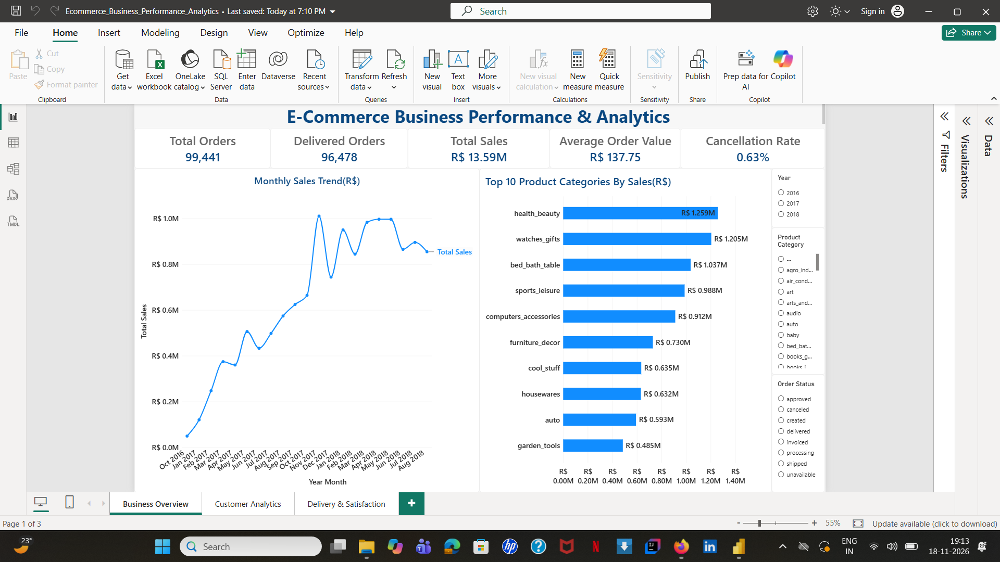
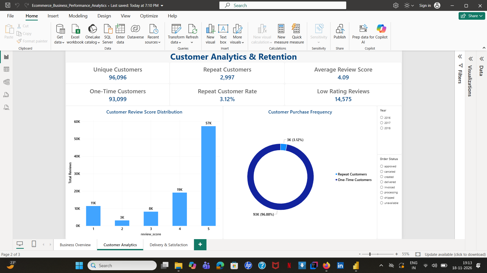
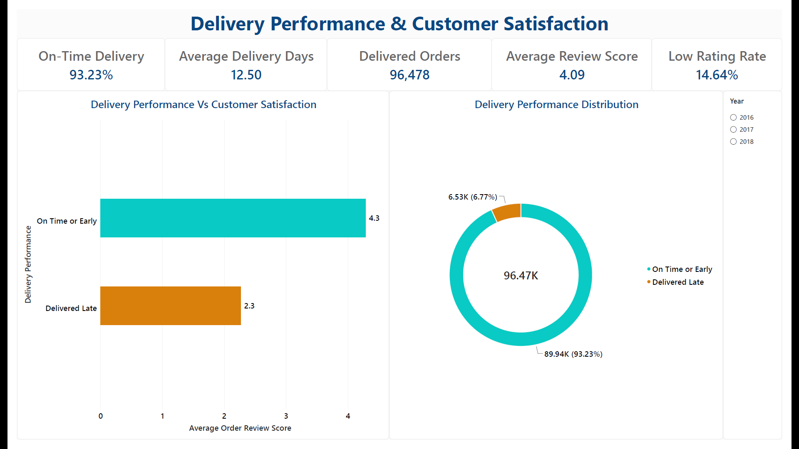

# E-Commerce Business Performance & Customer Analytics

## Project Overview

An end-to-end data analytics portfolio project using the Brazilian Olist E-Commerce Dataset to analyse sales performance, customer purchasing behaviour, delivery efficiency and customer satisfaction.

**Tools:** MySQL, Python, Excel, Power BI, DAX  
**Dataset:** Olist Brazilian E-Commerce Public Dataset  
**Data Period:** September 2016 – October 2018

## Technical Skills Demonstrated

| Technology | Application |
|---|---|
| SQL (MySQL) | Data validation, joins, aggregations, business KPIs |
| Python | Pandas, NumPy, exploratory analysis, Matplotlib |
| Excel | Supporting data inspection and validation |
| Power BI | Data modelling, DAX measures, interactive dashboards |
| Business Analytics | Sales, customer retention, delivery and satisfaction analysis |

## Business Objectives

- Analyse revenue trends and identify leading product categories.
- Understand customer purchasing behaviour and repeat purchases.
- Evaluate order fulfilment and delivery performance.
- Investigate the relationship between delivery delays and customer satisfaction.
- Develop an interactive Power BI dashboard for business performance monitoring.

## Dataset

The analysis includes approximately 99,000 orders, 96,000 unique customers and 112,000 order-item records, supported by product, payment, review and seller information.

## Analytical Approach

**SQL:** Imported and validated relational datasets, analysed sales and orders, calculated business KPIs, and investigated customer and delivery performance.

**Python:** Performed exploratory data analysis, validated KPIs, analysed customer retention and delivery performance, and created supporting visualisations.

**Excel:** Used as a supporting tool for data inspection and validation.

**Power BI:** Developed a three-page interactive report using data relationships, DAX measures, KPI cards, charts and slicers.

## Dashboard Pages

1. **Business Overview:** Sales, order volume, average order value, cancellations, monthly trends and leading product categories.
2. **Customer Analytics & Retention:** Unique customers, repeat purchasing, customer ratings and review distribution.
3. **Delivery Performance & Customer Satisfaction:** Delivery timeliness, delivery duration and the relationship between delivery performance and customer ratings.

## Key Performance Indicators

| KPI | Result |
|---|---:|
| Total Orders | 99,441 |
| Total Sales | R$13.59 million |
| Average Order Value | R$137.75 |
| Delivered Orders | 96,478 |
| Cancellation Rate | 0.63% |
| Unique Customers | 96,096 |
| Repeat Customer Rate | 3.12% |
| Average Review Score | 4.09 / 5 |
| Average Delivery Time | 12.50 days |
| On-Time Delivery Rate | 93.23% |

Sales are based on order-item prices, excluding freight, and should not be interpreted as net revenue or profit.

## Key Business Findings

### 1. Customer Retention

Only 3.12% of customers made repeat purchases during the observed dataset period. This suggests an opportunity to investigate repeat purchasing, customer engagement and retention strategies.

### 2. Delivery Performance and Satisfaction

Orders delivered on time or early received an average rating of approximately 4.3/5, compared with 2.3/5 for late deliveries.

This indicates a strong association between delivery timeliness and customer satisfaction, although it does not establish causation.

### 3. Product Category Performance

Health & Beauty and Watches & Gifts were among the highest sales-generating categories, making them important areas for category-level performance monitoring.

## Business Value & Recommendations

- Identified a 3.12% repeat customer rate, highlighting an opportunity to investigate customer retention.
- Evaluated delivery performance across more than 96,000 delivered orders.
- Found that late deliveries were associated with substantially lower customer review scores.
- Developed interactive dashboards to monitor sales, customer behaviour and operational KPIs.
- Recommended retention analysis, delivery monitoring and customer satisfaction improvements.

## Business Recommendations

- Investigate opportunities to improve repeat purchasing through customer engagement and retention initiatives.
- Monitor late deliveries and identify operational patterns associated with delays.
- Prioritise investigation of low-rated orders, particularly those associated with late deliveries.
- Track high-performing product categories and monitor changes in demand.

## Project Limitations

- The dataset is historical and does not represent current e-commerce performance.
- Sales exclude freight charges and do not represent profit.
- Reliable product cost data is unavailable, so profitability was not calculated.
- Some boundary months contain incomplete observations.
- Observed relationships do not necessarily establish causation.

## Dashboard Screenshots

### 1. Business Performance Overview

### 2. Customer Analytics & Retention

### 3. Delivery Performance & Customer Satisfaction

  

## Data Source

[Brazilian E-Commerce Public Dataset by Olist](https://www.kaggle.com/datasets/olistbr/brazilian-ecommerce)

## Project Status

Core analysis and dashboard development completed. Portfolio documentation and publication in progress.
